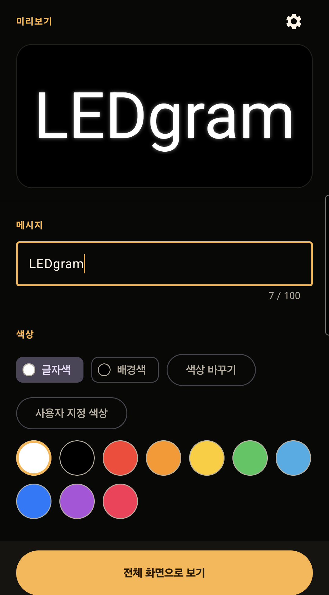
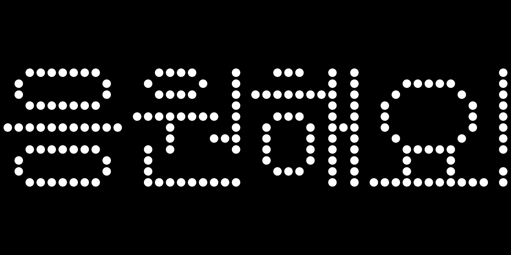
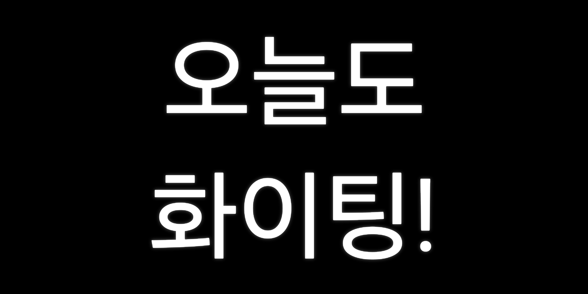

# LEDgram

[English](README.md)

LEDgram은 Android 스마트폰, 태블릿, 폴더블 기기를 밝고 자유롭게 꾸밀 수 있는 LED 전광판으로 바꾸는 앱입니다. Editor에서 문구를 만들고 즉시 미리 본 뒤, 행사·응원·안내 또는 일상적인 소통을 위해 전체 화면으로 표시할 수 있습니다.

## 주요 기능

- 글자색과 배경색, 굵게, 기울임, 밑줄 설정
- Text + Glow 및 Dot Matrix 표현 방식
- 고정 문구 또는 양방향 전광판 이동
- Blink, Pulse, Fade 효과와 독립적인 이동·효과 속도 조절
- 소프트 줄바꿈 없이 한글을 포함한 명시적 여러 줄 입력
- 스마트폰, 태블릿, 폴더블 기기에서 부드러운 화면 방향 추적과 Lock/Unlock을 지원하는 몰입형 전체 화면 Display
- 앱을 다시 실행해도 유지되는 Editor 설정
- Settings, 개인정보 처리방침, 법적 고지를 제공하는 한국어 및 영어 인터페이스
- 필요한 지역에서 UMP 동의 및 개인정보 보호 옵션을 제공하는 Google Mobile Ads

## 스크린샷

### Editor와 실시간 미리보기

### Dot Matrix Display

### 여러 줄 Display

## 기술 구성

- Kotlin 2.4.21
- Jetpack Compose(BOM 2025.11.00) 및 Material 3
- AndroidX DataStore 1.2.1 및 Android SDK 24–36
- Google Mobile Ads 25.5.0 및 UMP 4.0.0
- Kotlin DSL 기반 Android Gradle Plugin 9.4.1 및 Gradle 9.8.0

## 출시 상태

- **현재 업데이트:** 0.9.10 (19), Google Play 비공개 테스트 검토를 위해 제출됨
- **이전 Play 출시:** 0.9.9 (18)
- **프로덕션 출시:** 아직 프로덕션 버전으로 제공되지 않음

## 개발자

LEDgram은 **Gowl Labs**에서 개발합니다.

## 링크

- [공개 웹사이트](https://chiffon95.github.io/ledgram-pages/)
- [개인정보 처리방침 — 영어](https://chiffon95.github.io/ledgram-pages/privacy/)
- [개인정보 처리방침 — 한국어](https://chiffon95.github.io/ledgram-pages/privacy/ko.html)

## 라이선스

이 프로젝트에는 오픈 소스 라이선스가 공개되어 있지 않습니다. 모든 권리는 Gowl Labs에 있습니다.
