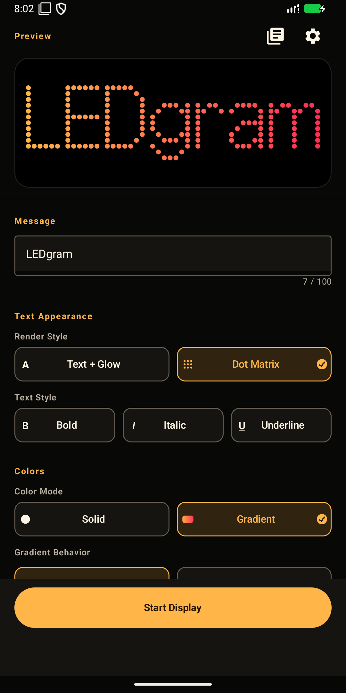
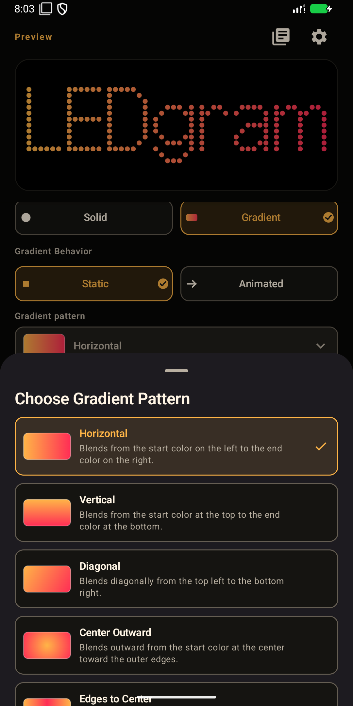
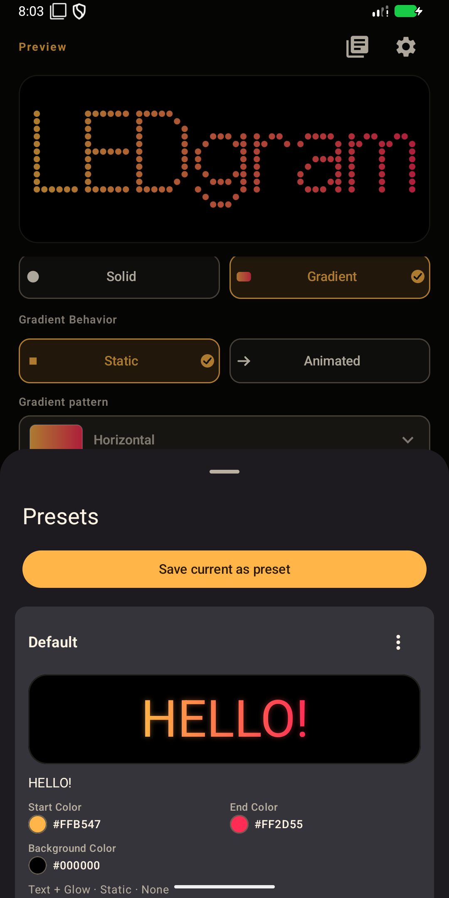
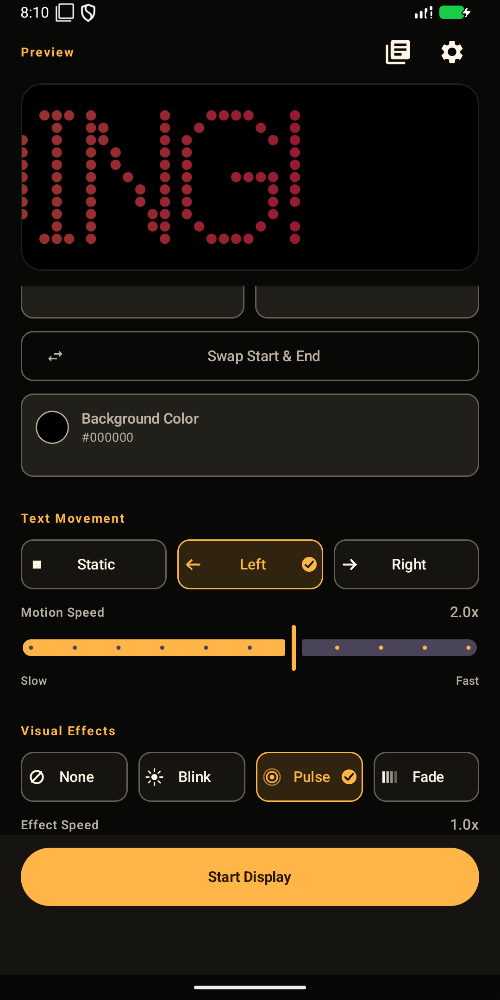
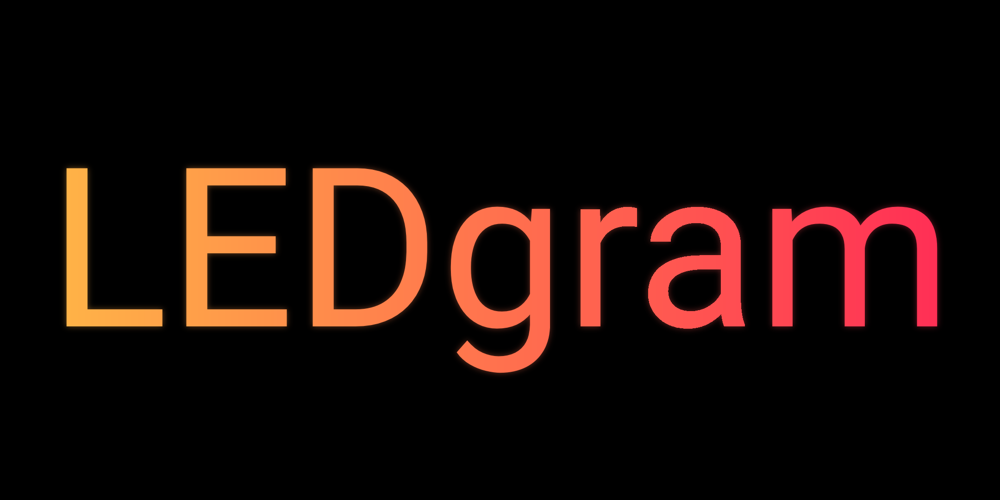
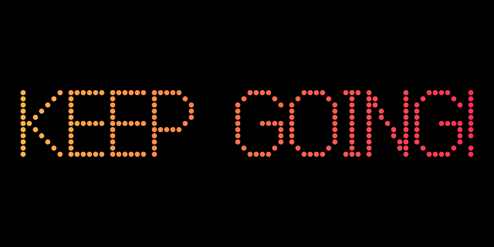

# LEDgram

[한국어](README.ko.md)

LEDgram turns an Android phone, tablet, or foldable into a bright, customizable LED message display. Create a message in the Editor, preview it instantly, and show it full-screen for events, cheering, announcements, or everyday communication.

## Highlights

- Solid text and background colors plus six static and four animated text gradient patterns with independent gradient speed
- Bold, italic, and underline text styles
- Text + Glow and Dot Matrix display styles
- Static text or marquee motion in either direction
- Blink, Pulse, and Fade effects with independent motion and effect speeds
- Explicit multiline input without soft wrapping, including Hangul text
- Immersive full-screen Display with smooth orientation following and Lock/Unlock controls on phones, tablets, and foldables
- Editor settings preserved between sessions
- Local preset library with saved previews, details, create, load, rename, explicit overwrite, delete, load Undo, and an editable initial Default preset
- New installations start with a static horizontal Brand Amber-to-Pink gradient; existing saved Editor configurations and presets remain unchanged
- System Default plus 14 bundled selectable languages: English, Korean, Japanese, Simplified Chinese, Spanish (Spain), Spanish (Latin America), Portuguese (Brazil), French, German, Italian, Indonesian, Vietnamese, Thai, and Arabic with right-to-left layout support
- Full-screen Display without ads and no account or login requirement
- Google Mobile Ads with UMP consent and privacy options where applicable

## Screenshots

### Editor overview

### Gradient patterns

### Presets

### Motion and effects

### Text + Glow display

### Dot Matrix display

## Technology

- Kotlin 2.4.21
- Jetpack Compose (BOM 2025.11.00) and Material 3
- AndroidX DataStore 1.2.1 and Android SDK 24–36
- Google Mobile Ads 25.5.0 and UMP 4.0.0
- Android Gradle Plugin 9.4.1 and Gradle 9.8.0 with Kotlin DSL

## Release status

- **Published version:** 1.2.0 (26), available on Google Play
- **Install:** [Get LEDgram on Google Play](https://play.google.com/store/apps/details?id=com.gwolbisa.ledgram)

## Developer

LEDgram is developed by **Gwol Labs**.

## Links

- [Public website](https://chiffon95.github.io/ledgram-pages/)
- [Privacy Policy — English](https://chiffon95.github.io/ledgram-pages/privacy/)
- [Privacy Policy — Korean](https://chiffon95.github.io/ledgram-pages/privacy/ko.html)

## License

No open-source license has been published for this project. All rights are reserved by Gwol Labs.

LEDgram bundles [Galmuri11](https://github.com/quiple/galmuri) by Lee Minseo under the SIL Open Font License 1.1. The OFL applies to the bundled font, not to LEDgram's application source code.
